# Entrega — Estação Cofre (Segurança, Autenticação e Criptografia)

**Alunos:** Marcelo e Milton
**Turma:** AMF 2026-02
**Prefixo MQTT (`NOME`):** `sis1a/marcelo/`
**Link do Worker:** `https://holy-wind-25bc.marcelotellesest.workers.dev`

---

## Evidências (prints)

> Uso macOS, por isso rodei os equivalentes em bash dos scripts (`scripts/ataques.sh` no lugar de `ataques.ps1`). Os
> testes e o corpo das requisições são os mesmos. O ESP32 rodou no **Wokwi** (DHT22 no GPIO 4, LED no GPIO 2).

### Passo 1 — Antes de trancar
- `ataques.sh -t Falso -c` contra o Worker **antigo** (sem nenhuma chave) → **200** `OK: temp=999`. Qualquer pessoa
  com a URL gravava no banco. A primeira execução da print ainda pegou o Worker novo (401); a segunda, já com o
  Worker antigo publicado, gravou o 999:

  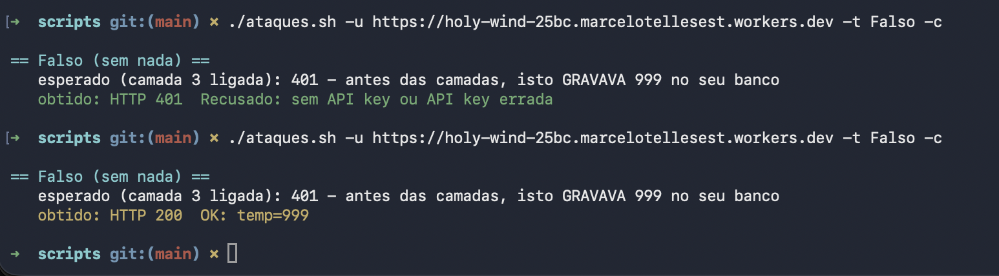

- `cofre.html` em `ws :8080`, mostrando estações da turma **LEGÍVEIS**: *sem print.* No meu Chrome, o `ws://` sem
  TLS era derrubado (`ERR_CONNECTION_CLOSED`). Na seção 1 das prints do Passo 7, as mensagens de outro aluno
  (`sis1a/emanoel_iot/...`) aparecem em vermelho **LEGÍVEL**, com temperatura e umidade em texto puro.

### Passo 3 — Camada 2 (API key)
- `ataques.sh -t Todos` com a API key: `Falso`/`SemChave` → 401, `ComChave` → 200:

  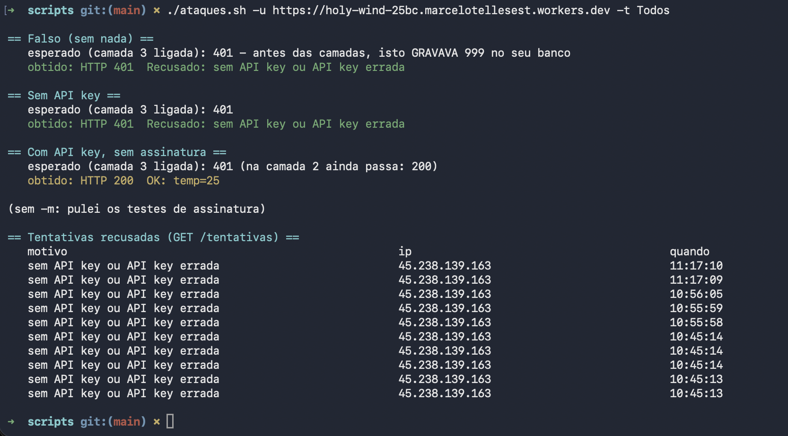

### Passo 4 — Camada 1 (TLS)
- Serial Monitor: NTP ok, MQTT na **8885** ok, HTTPS com **200**. A print que eu tinha mostrava a aba `config.h`
  aberta, com as chaves, então não entreguei. As chaves daquela print já foram trocadas. Trecho do Serial:

  ```
  [WiFi] conectando......... ok | IP=10.10.0.2 | RSSI=-94 dBm
  [NTP] sincronizando relogio................... ok (1795018322)
  [MQTT] conectando em test.mosquitto.org:8885 (TLS + login)... ok
  [HTTPS] {"nome":"marcelo","sensor":"temp","valor":24.0,"ts":1795018327} -> 200 OK: temp=24
  ```

- Serial Monitor com a **CA errada** (`tlsMqtt.setCACert(CA_WORKER)`): falha de TLS
  (`X509 - Certificate verification failed`), e o ESP32 se recusa a conectar:

  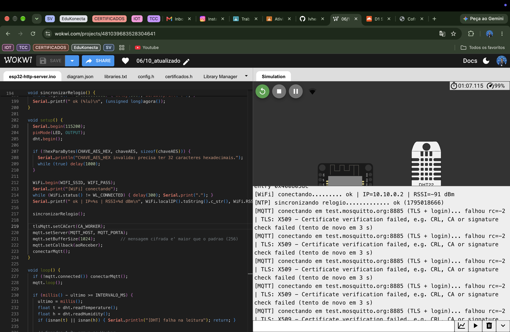

### Passos 5 e 6 — Camada 3 (HMAC + anti-replay)
- **Antes** (`EXIGIR_ASSINATURA = nao`): `Adulterado` (grava **45**), `Replay` (2×) e `Atrasado` passando com 200:

  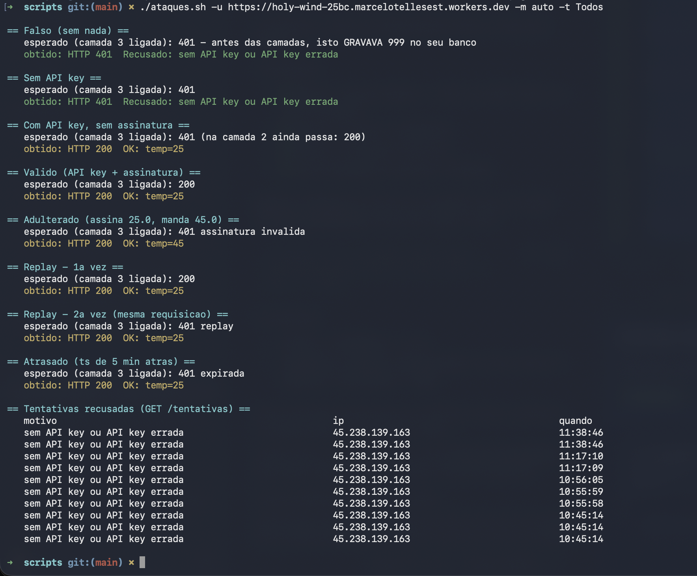

- **Depois** (`EXIGIR_ASSINATURA = sim`): `Adulterado` 401, `Replay` 200 → 401, `Atrasado` 401. A lista de
  **tentativas recusadas** aparece no fim da print:

  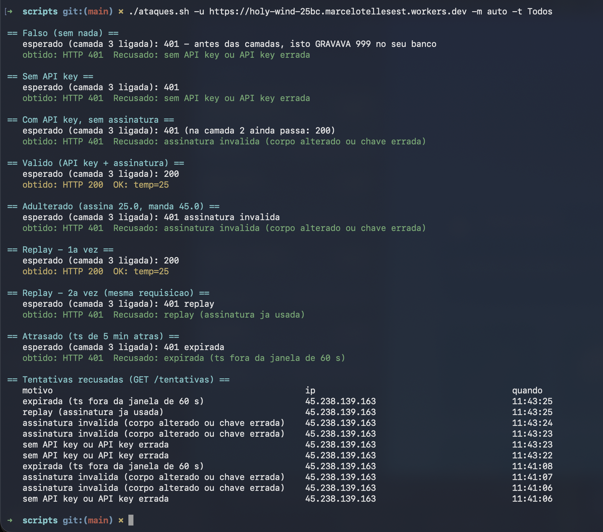

### Passo 7 — Camada 4 (cofre AES-GCM)
- O tópico `sis1a/marcelo/cofre` aparece como **CIFRADO** na seção 1 (as mensagens do colega ao lado continuam
  LEGÍVEIS), e os valores são **decifrados** com a chave certa (✔ aberto):

  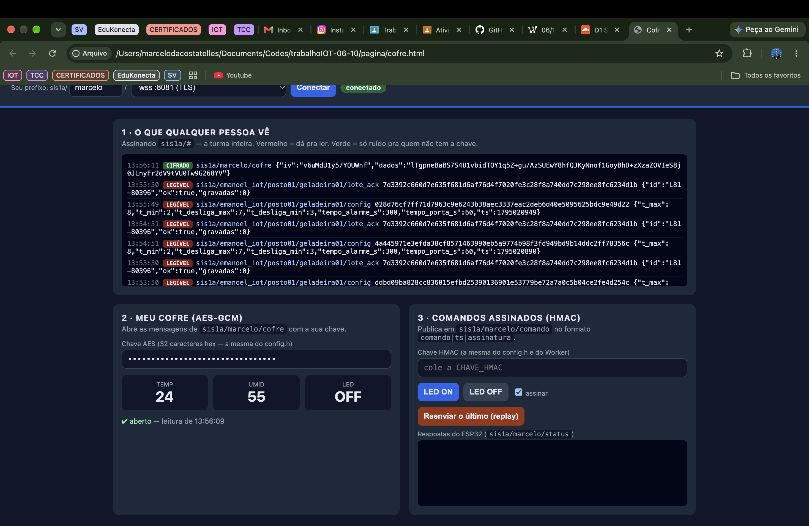

- Chave com 1 caractere trocado (✘ não abriu). Sem colega disponível na hora; uma chave de outra pessoa é só
  outra chave errada, e cai no mesmo caso: a tag do GCM não confere:

  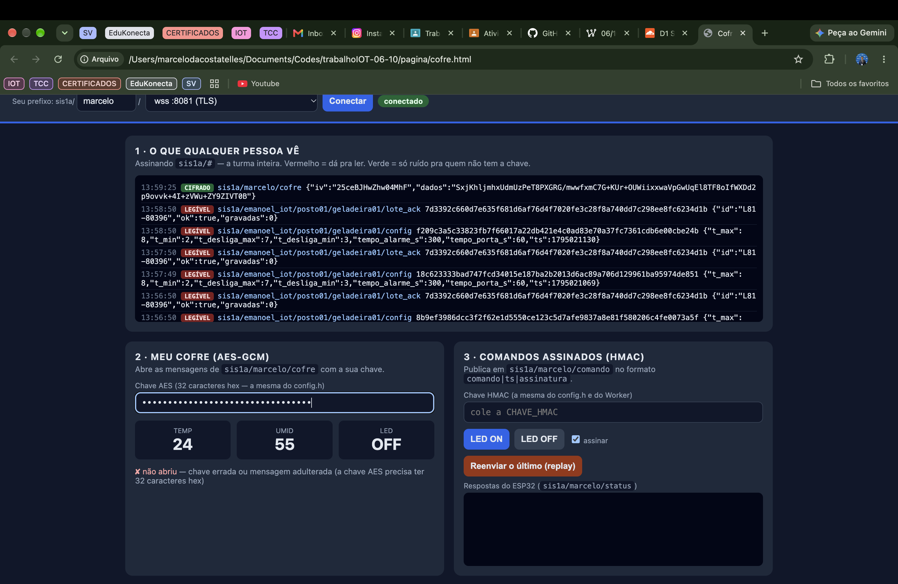

### Passo 8 — Comandos assinados
- `OK: led:ON` (assinado), na página e no Serial, com o LED aceso no Wokwi:

  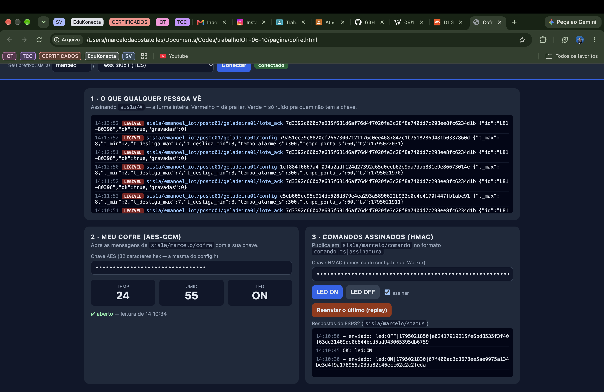
  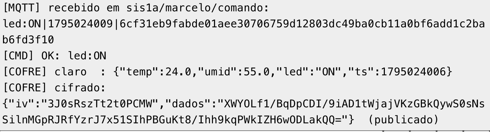
  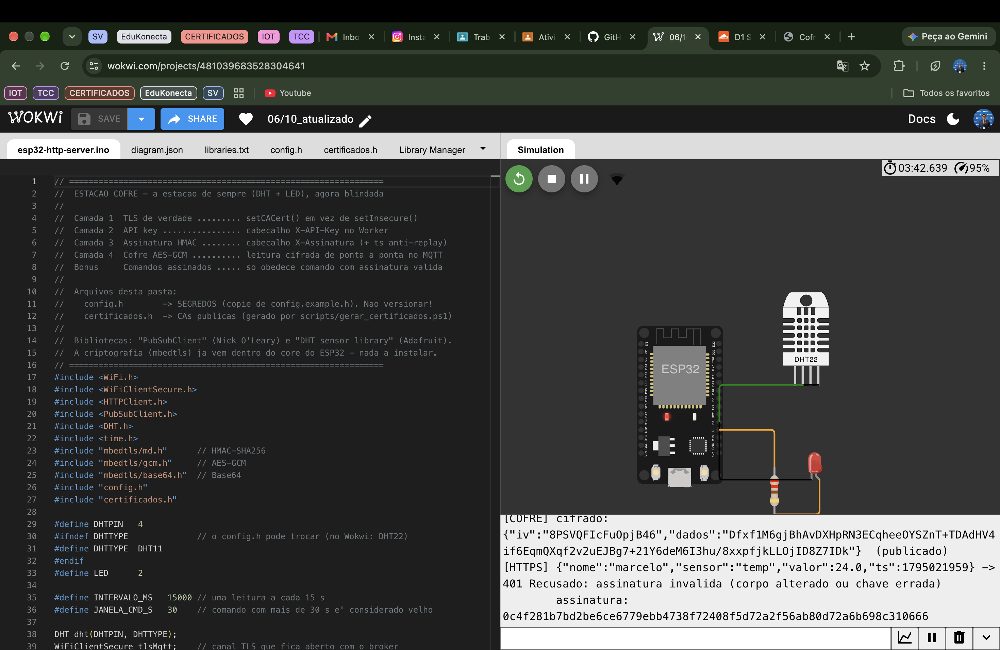

- `RECUSADO: sem assinatura`: *sem print* (o Wokwi ficou instável no fim). No `aoReceber()`, uma mensagem sem os
  dois `|` é recusada antes de qualquer outra checagem.
- `RECUSADO: replay (comando repetido)`: *sem print*. O ESP32 guarda o `ts` do último comando aceito
  (`ultimoTsCmd`) e recusa qualquer comando com `ts` igual ou menor.
- `RECUSADO: assinatura invalida` (comando assinado com uma chave HMAC sorteada pelo `gerar_chaves.sh`, que faz o
  papel da chave de um colega):

  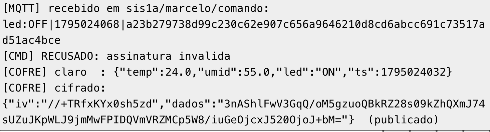

---

## O que vocês mudaram no código

- O `worker.js` ficou como veio. Na página, só troquei o prefixo padrão para `marcelo`. O `config.h` foi preenchido
  e não está no repositório.
- **Cofre não chegava na página (Wokwi):** no Wokwi cada HTTPS leva uns 15 s, e nesse tempo o ESP32 não fala com o
  broker. O keepalive padrão do PubSubClient é de 15 s, então o broker derrubava a conexão, e o `publish` do cofre,
  feito depois dos HTTPS, falhava sem nenhum aviso. No `.ino`, aumentei o keepalive (`setKeepAlive(120)`), passei a
  publicar o cofre **antes** dos HTTPS e a mostrar no Serial se o publish deu certo.
- **Comandos travados (Wokwi):** quando o handshake HTTPS emperrava, o `WiFiClientSecure` esperava até 120 s (o
  padrão), e nesse tempo o ESP32 não lia os comandos. Limitei a espera (`setHandshakeTimeout(15)` e timeouts de 10 s
  no `HTTPClient`) e aumentei a janela dos comandos de 30 s para 60 s. O replay continua bloqueado, porque o
  `ultimoTsCmd` só aceita `ts` maior que o do último comando.
- **Relógio atrasando (Wokwi):** depois de alguns minutos, o Worker passava a responder `401 expirada`. O tempo
  simulado do Wokwi anda mais devagar que o real, então o relógio do ESP32, acertado pelo NTP só no início, ficava mais
  de 60 s atrás do da Cloudflare. Agora o `loop()` chama o `configTime()` a cada minuto e acerta o relógio de novo. É
  a proteção anti-replay (o `ts` dentro da janela) funcionando: ela depende de relógio certo nas duas pontas.
- **Login do broker:** hoje o `test.mosquitto.org` recusa `rw`/`readwrite` na porta 8885 (`rc=5`, não autorizado),
  mas aceita conexão sem login. Por isso deixei `MQTT_USER` e `MQTT_PASS` vazios no `config.h`. A conexão continua
  em TLS na 8885, e o ESP32 continua validando a CA do Mosquitto.
- **Anti-replay no D1:** no Passo 6, o `Replay` passou na 2ª vez porque a tabela `assinaturas_usadas` existia sem
  `PRIMARY KEY` em `assinatura`. Como o `schema.sql` usa `IF NOT EXISTS`, rodar ele de novo não corrigia a tabela.
  Sem essa restrição, o `INSERT OR IGNORE` gravava a assinatura repetida (`changes = 1`) e o Worker não detectava o
  replay. Apaguei a tabela e criei de novo com `assinatura TEXT PRIMARY KEY`. Depois disso, a 2ª vez do replay deu 401.
- Uso macOS e não tenho PowerShell, então escrevi versões em bash dos scripts, que fazem a mesma coisa:
  `scripts/gerar_chaves.sh` (usa `openssl rand`), `scripts/gerar_certificados.sh` (pega a cadeia com
  `openssl s_client` e busca a CA raiz nas raízes do macOS) e `scripts/ataques.sh` (os mesmos testes, com `curl` e
  `openssl dgst -hmac`). O `ataques.sh` lê as chaves direto do `config.h`, assim elas não aparecem no terminal nem
  nos prints.
- Criei um `.gitignore` que deixa o `config.h` fora do repositório.
- Rodei no **Wokwi** (DHT22 no GPIO 4, LED no GPIO 2: `diagram.json`). No `.ino`, o `DHTTYPE` passou a vir do
  `config.h` (`#ifndef DHTTYPE`), então dá pra trocar entre DHT11 e DHT22 sem mexer no código.

---

## Respostas

1. **No Passo 4 vocês trocaram a CA e a conexão falhou. Por que *falhar* é o comportamento correto? O que aconteceria com `setInsecure()` nessa mesma situação?**

   Com a CA errada, o ESP32 não tem como confirmar que o certificado apresentado é mesmo do `test.mosquitto.org`. Para ele, a situação é igual à de um *man-in-the-middle* se passando pelo servidor, então recusar a conexão é o certo. Com `setInsecure()`, o ESP32 aceitaria qualquer certificado e conectaria normalmente, inclusive com um impostor. O canal continuaria cifrado, só que com o atacante, que leria e poderia alterar tudo.

2. **O TLS já cifra o caminho até o broker. Por que, mesmo assim, a temperatura aparecia legível para a turma no Passo 1, e por que o AES-GCM resolve isso?**

   O TLS protege só o trecho entre o meu ESP32 e o broker. Ao chegar lá, a mensagem é decifrada, e o broker repassa em claro para qualquer pessoa assinada em `sis1a/#`. Num broker público, isso é a turma inteira. No Passo 1 nem TLS havia, mas mesmo com ele a mensagem continuaria legível dentro do broker. O AES-GCM cifra a mensagem em si, antes de ela sair do ESP32. O broker e os colegas só recebem ruído, e somente quem tem a chave (a minha página) consegue abrir. Além disso, a tag do GCM mostra se alguém alterou algum bit no caminho.

3. **Comparem API key e assinatura HMAC: o que um atacante consegue fazer se capturar *uma* requisição de cada tipo?**

   - **API key:** a chave vai no cabeçalho de toda requisição. Quem captura uma única requisição passa a ter a chave e pode gravar qualquer valor, quantas vezes quiser, até ela ser trocada.
   - **HMAC:** a captura entrega uma assinatura que só vale para aquele corpo exato. Se o atacante mudar o valor, a assinatura não confere (teste `Adulterado`). Se reenviar a requisição igual, ela cai no anti-replay: o `ts` sai da janela de 60 s e a assinatura já foi usada (testes `Replay` e `Atrasado`). Na prática, a captura não serve para nada, porque o segredo nunca passou pela rede.

4. **O `ts` vai *dentro* do corpo assinado. O que daria errado se ele fosse num cabeçalho separado, fora da assinatura?**

   Como a assinatura não cobriria o `ts`, o atacante pegaria uma requisição antiga, colocaria o horário atual no cabeçalho e reenviaria. A assinatura continuaria válida e a checagem de tempo seria enganada. Restaria só a tabela de assinaturas usadas, que o Worker limpa depois de 5 min. Depois disso, o replay de uma requisição antiga voltaria a funcionar.

5. **Por que o Worker faz `request.text()` e assina o texto cru, em vez de fazer `request.json()` e montar o JSON de novo pra conferir?**

   O HMAC é calculado sobre bytes, e quem assinou foi o texto exato que o ESP32 enviou. Remontar o JSON pode mudar esses bytes sem mudar o significado: espaços, ordem das chaves, `24.0` virando `24`, escape de caracteres. Aí a assinatura deixa de bater mesmo numa mensagem legítima. Também existe o risco contrário: o parser poderia interpretar algo diferente do que foi assinado. Conferir o texto cru primeiro e só depois fazer o `JSON.parse` garante que o Worker usa exatamente o que foi autenticado.

6. **As rotas `/list` e `/resumo` continuam abertas. Isso é problema? Para que tipo de dado (pensem no Projeto Final de vocês) passaria a ser?**

   Para a temperatura de uma sala, não muito, porque é um dado público e pouco sensível. Seria um problema com dados que revelam algo sobre pessoas ou sobre a segurança do lugar: sensor de presença ou de porta (mostra quando a casa está vazia), consumo de energia (mostra a rotina), localização, dados de saúde, estado de uma fechadura ou de um alarme. Nesses casos, a leitura também precisa passar por `autenticar()` ou por um login.

7. **A chave AES foi colada à mão na página. Como resolver isso num produto com mil dispositivos vendidos?**

   Com criptografia assimétrica. Cada dispositivo sai de fábrica com um par de chaves próprio, ou um certificado, e a chave privada fica na flash cifrada ou num elemento seguro. Ao ser associado à conta do dono, o dispositivo combina uma chave de sessão AES (por exemplo, via ECDH) com o servidor ou o app, sem que essa chave passe em claro pela rede. Assim cada dispositivo tem a sua chave: se uma vazar, só aquele aparelho é afetado, e a chave dele pode ser revogada ou trocada.

8. **No seu Projeto Final, qual é o pior estrago que alguém faria sem as camadas de hoje? Qual camada vocês vão levar pra lá, e por quê?**

   O nosso projeto é o monitoramento de um **silo de grãos**: o ESP32 mede temperatura e umidade da massa de grãos
   e liga o **ventilador de aeração** por um relé. O pior estrago que alguém faria sem as camadas de hoje:
   - **Mandar no ventilador:** com o tópico de comando aberto, como no buraco 4, qualquer pessoa no broker poderia
     desligar a aeração quando o grão está esquentando, o que leva a fungos, perda do lote e até risco de combustão.
     Também poderia deixar o ventilador ligado o tempo todo, gastando energia e secando o grão demais.
   - **Mandar leituras falsas:** com o `/insert` aberto, alguém gravaria temperaturas normais enquanto o silo
     esquenta, e o alarme e a automação nunca disparariam. Ou gravaria valores absurdos para ligar o ventilador à toa.
   - **Ler os dados:** em texto puro no broker, a turma inteira veria o estado do silo e do estoque.

   Vamos levar principalmente o **comando assinado** (`comando|ts|assinatura`, do Passo 8): só quem tem a
   `CHAVE_HMAC` liga ou desliga o ventilador, e o `ts` com a checagem de replay impede que alguém grave um
   "desligar" e repita depois. Junto com ele vão a **assinatura HMAC no `/insert`** (ninguém injeta leitura falsa
   ou adulterada), o **TLS com `setCACert()`** em todas as conexões (ninguém se passa pelo broker nem pelo Worker), a
   **validação de faixa** no Worker e o **`config.h` no `.gitignore`**.

---

## Desafios extras (opcional)

- **Dado adicional autenticado:** passar o nome do tópico como *AAD* no AES-GCM
  (`mbedtls_gcm_crypt_and_tag(..., aad, aad_len, ...)`), pra que uma mensagem do `/cofre` de
  um colega não possa ser "transplantada" pro seu tópico.
- **Uma chave por dispositivo:** o Worker aceitar duas estações, cada uma com sua `CHAVE_HMAC`,
  escolhida pelo campo `nome` do corpo.
- **Alarme:** quando `/tentativas` passar de 10 recusas em 1 minuto, o Worker publicar um aviso
  (ou o ESP32 piscar o LED).
- **Rotação de chave:** trocar a `CHAVE_HMAC` sem derrubar o sistema (o Worker aceita a antiga e a
  nova por um tempo).

---

**Entrega:** este `ENTREGA.md` preenchido, `estacao_cofre.ino`, `worker.js` e `certificados.h`, no
GitHub de cada um, **sem o `config.h`**.
